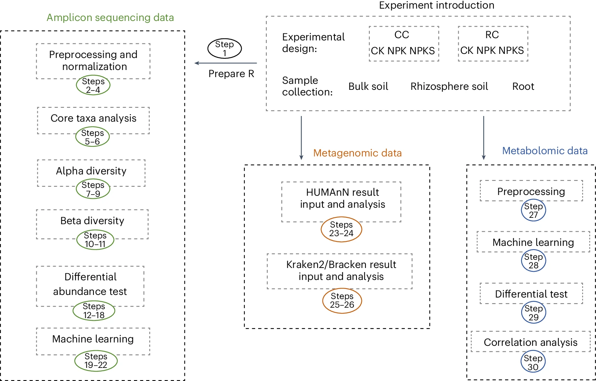
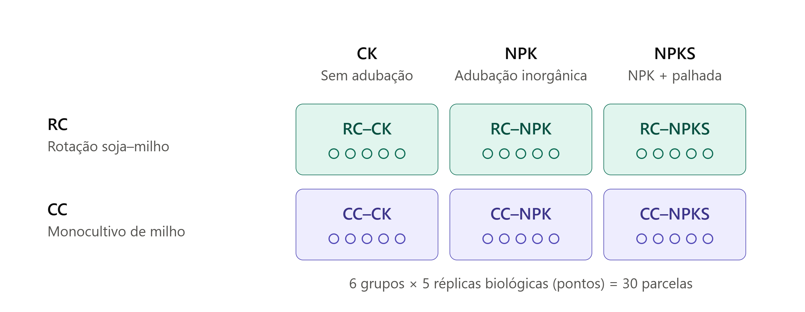
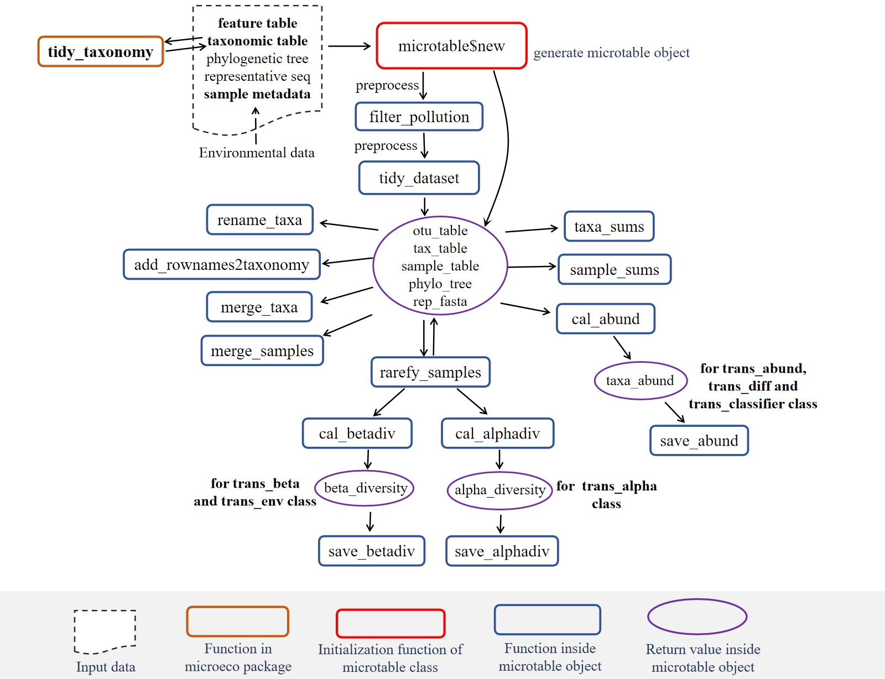
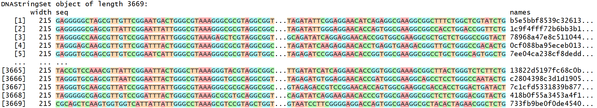
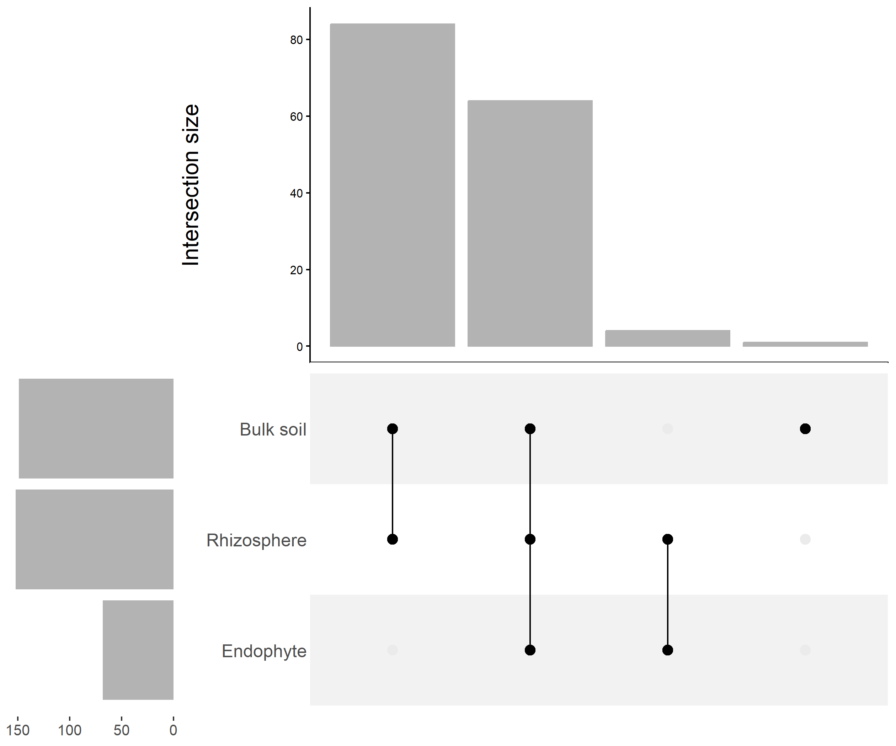
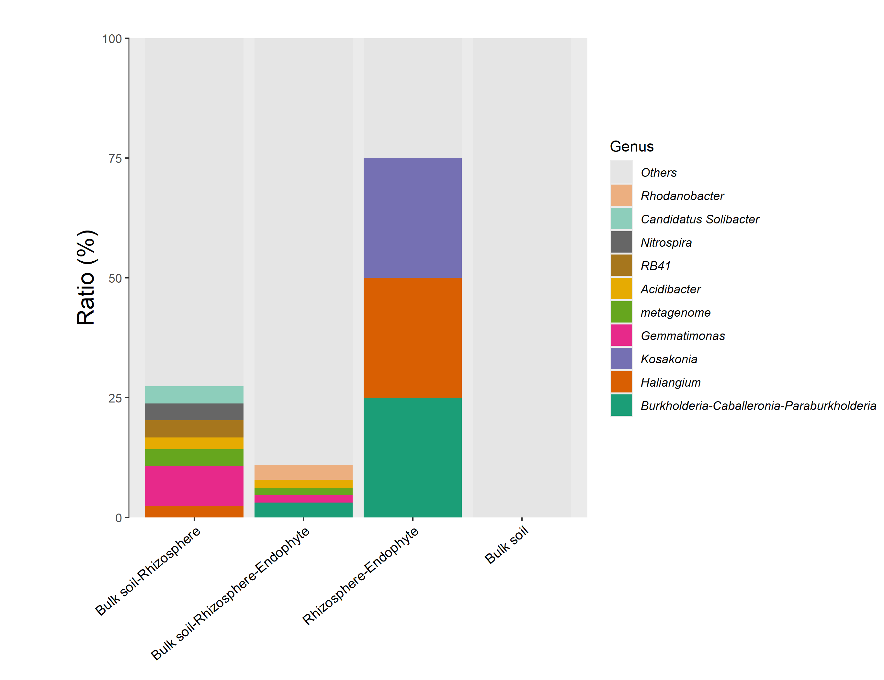

# Visão geral da atividade prática {.divider style="text-align: center;"}

<!-- Reduce code font size in revealjs slides so code fits on a single slide -->
```{=html}
<style>
.reveal pre[class*="language-"],
.reveal code[class*="language-"],
.reveal .sourceCode,
.reveal .highlight {
  font-size: 0.75em !important;
  line-height: 1.1 !important;
}
</style>
```

## Panorama de análises

::: {style="text-align: center; font-size: 0.7em;"}
Vamos focar em dados de amplicons

{width=70%}

*Liu et al. (2025)*
:::

## Recursos computacionais {.smaller}

::: {.incremental}
- Sistema Operacional: Linux Ubuntu ou Windows
- Softwares
  - R 4.4 ou superior (recomendação do microeco)
  - RStudio (testado com a versão `2026.10.1`)
:::

## Experimento da atividade prática {.smaller}

::: {style="text-align: center; font-size: 0.7em;"}


{width=100%}

Ilustração criada usando Claude (Opus 5.5), a partir de [Liu, Chi, et al. 2025](https://link.springer.com/article/10.1007/s11104-024-06847-9)

:::

## Dados da atividade prática {.smaller}

::: {.incremental}
- Dados de amplicons
  - Illumina NovaSeq 6000 platform
  - Dados paired-end
  - Gene 16S rRNA, região variável V4-V5, primers 515F e 926R
  - Dados já processados baixados de [https://github.com/ChiLiubio/microeco_protocol_v1](https://github.com/ChiLiubio/microeco_protocol_v1) (associado ao protocolo de [Liu et al. (2025)](https://www.nature.com/articles/s41596-025-01239-4))
  - Metadados associados às amostras baixados do mesmo repositório
:::

## Pasta de trabalho {.smaller}

::: {.incremental}
 * Pasta de trabalho: `Aula_pratica_microbiomas_2026`
 * `File` > `New Project` > `Existing Directory`  (`RStudio 2026.10.1`)
:::

## Instalação de pacotes de R {.smaller}

O arquivo `RCode/Step1_Install_packages.R` no Github do protocolo da Nature apresenta uma lista completa de linhas de instalação.

Nesta prática, instalaremos os seguintes pacotes:

```R
install.packages(microeco)
install.packages("BiocManager")
install.packages("file2meco", repos = BiocManager::repositories())
```

## Microtable

::: {style="text-align: center; font-size: 0.7em;"}

{width=60%}

https://chiliubio.github.io/microeco_tutorial/basic-class.html#microtable-class

:::


## Microtable - tabela de contagens

```R
library(microeco)
library(file2meco)
library(magrittr)
library(readxl)

# Tabela de contagens de ASVs
feature_table <- read.table("dados_amplicons/QIIME2_converted/feature_table.tsv",
  sep = "\t", skip = 1, comment.char = "$", header = TRUE, row.names = 1)
head(feature_table)
```

## Microtable - tabela de taxonomia

```R
# Tabela de taxonomia
taxonomy_table_raw <- read.table("dados_amplicons/QIIME2_converted/taxonomy.tsv",
  sep = "\t", skip = 1, comment.char = "$", header = FALSE)
head(taxonomy_table_raw)
# 
taxonomy_table <- file2meco:::split_assignments(taxonomy_table_raw[, 2],
  ranks = c("Kingdom", "Phylum", "Class", "Order", "Family", "Genus", "Species"), split = ";") %>% as.data.frame
head(taxonomy_table)

rownames(taxonomy_table) <- taxonomy_table_raw[, 1]
head(taxonomy_table)
```

## Microtable - árvore filogenética

```R
# Árvore filogenética
tree <- ape::read.tree("dados_amplicons/QIIME2_converted/tree.nwk")
```

## Microtable - sequências de ASVs

```R
sequences <- Biostrings::readDNAStringSet("dados_amplicons/QIIME2_converted/dna-sequences.fasta")
# Visualizando o objeto criado
sequences
```
::: {style="text-align: center; font-size: 0.7em;"}

{width=100%}

:::

## Microtable - informações de amostras

```R
# read sample information into R
tmp_sample <- as.data.frame(read_excel("dados_amplicons/QIIME2_converted/Sample_info.xlsx",
  col_names = TRUE),
  stringsAsFactors = FALSE)
# row names are necessary and should be in accordance with those in feature abundance table
rownames(tmp_sample) <- tmp_sample[, 1]
head(tmp_sample)
```

## Microtable - construindo o objeto microtable

```R
microtable_obj <- microtable$new(sample_table = tmp_sample,
  otu_table = feature_table,
  tax_table = taxonomy_table,
  phylo_tree = tree,
  rep_fasta = sequences)

# tidy all the data inside the object to ensure that samples and features correspond across different data
microtable_obj$tidy_dataset()

# tidy taxonomy information to unify the naming of taxonomy
microtable_obj %<>% tidy_taxonomy
```

## Microtable - pré-processamento do objeto microtable

```R
microtable_obj$tax_table %<>% base::subset(Kingdom == "k__Archaea" | Kingdom == "k__Bacteria")
microtable_obj$filter_pollution(taxa = c("mitochondria", "chloroplast"))
unique(microtable_obj$tax_table$Kingdom)

microtable_obj$tidy_dataset()

# Verificando a variação de tamanho de amostras
microtable_obj$sample_sums() %>% range

# Atribuindo níveis aos diferentes fatores experimentais na tabela de amostras
microtable_obj$sample_table$Compartment %<>% factor(., levels = c("Bulk soil", "Rhizosphere", "Endophyte"))
microtable_obj$sample_table$Fertilization %<>% factor(., levels = c("CK", "NPK", "NPKS"))
microtable_obj$sample_table$Cropping %<>% factor(., levels = c("CC", "RC"))
microtable_obj$sample_table$Group %<>% factor(., levels = c("CC-CK", "RC-CK", "CC-NPK", "RC-NPK", "CC-NPKS", "RC-NPKS"))
```

## Normalização de dados de amplicons

Rarefação, incluindo apenas amostras com mais de 2.000 leituras

```R
tmp <- trans_norm$new(dataset = microtable_obj)

microtable_obj$sample_sums() %>% range
amplicon_16S_microtable_rarefy <- tmp$norm(method = "rarefy", sample.size = 2000)
```


## Análise do microbioma "core"

Identificação dos grupos de microrganismos presentes amplamente e que são abundantes nas amostras.

```R
library(ggplot2)

# Definindo taxons "core"
# Frequência de ocorrência: 50%
# Média relativa de abundância: 0.05%
freq <- 0.5
abund <- 0.0005

# Taxons "core" para cada compartimento
S <- clone(amplicon_16S_microtable_rarefy)
S$sample_table %<>% .[.$Compartment == "Bulk soil", ]
S$tidy_dataset()
S$filter_taxa(rel_abund = abund, freq = freq)

RS <- clone(amplicon_16S_microtable_rarefy)
RS$sample_table %<>% .[.$Compartment == "Rhizosphere", ]
RS$tidy_dataset()
RS$filter_taxa(rel_abund = abund, freq = freq)

R <- clone(amplicon_16S_microtable_rarefy)
R$sample_table %<>% .[.$Compartment == "Endophyte", ]
R$tidy_dataset()
R$filter_taxa(rel_abund = abund, freq = freq)
```

## Análise do microbioma "core"

```R
# Combinando as ASV "core" em um único data.frame
core_res <- rbind(data.frame(compartment = "S", ASV = S$taxa_names()),
  data.frame(compartment = "RS", ASV = RS$taxa_names()),
  data.frame(compartment = "R", ASV = R$taxa_names()))
head(core_res)
```


```R
# generate a total core-taxa microtable object according to names
tmp_microtable <- clone(amplicon_16S_microtable_rarefy)
tmp_microtable$otu_table %<>% .[rownames(.) %in% c(S$taxa_names(), RS$taxa_names(), R$taxa_names()), ]
tmp_microtable$tidy_dataset()
# Combinando amostras para cada compartimento
tmp_merge <- tmp_microtable$merge_samples("Compartment")

head(tmp_merge$sample_table)
head(tmp_merge$otu_table)

# Análise da interseção usando a classe trans_venn
trans_vennobj <- trans_venn$new(tmp_merge, ratio = "numratio", name_joint = "-")
# Removendo grupos com zeros
trans_vennobj$data_summary %<>% .[.$Counts != 0, ]
```

## Gerando figura do microbioma "core"

```R
g1 <- trans_vennobj$plot_bar(sort_samples = FALSE, left_background_fill = "white")
cowplot::save_plot("Coretaxa_intersection.png", g1, base_aspect_ratio = 1.2, dpi = 300, base_height = 7)
```

## Gerando figura do microbioma "core"

::: {style="text-align: center; font-size: 0.7em;"}

{width=60%}

:::


## Gerando figura do microbioma "core"

```R
# transform intersection data to microtable object for other visualization
trans_vennobj_mt <- trans_vennobj$trans_comm(use_frequency = TRUE)
# calculate 'relative abundance'
trans_vennobj_mt$cal_abund()
tmp_x <- trans_vennobj$data_summary %>% tibble::rownames_to_column(.) %>% .[order(.$Counts, decreasing = TRUE), ] %>% .$rowname
# for visualization
trans_vennobj_mt_abund <- trans_abund$new(dataset = trans_vennobj_mt, taxrank = "Genus", ntaxa = 10)
# order_x: adjust the order of groups to be same with the order in 'Coretaxa_intersection.png'
g2 <- trans_vennobj_mt_abund$plot_bar(bar_full = TRUE, legend_text_italic = TRUE, xtext_angle = 40, order_x = tmp_x)
# add title in y-axis; add more space in the figure left
g2 <- g2 + ylab("Ratio (%)") + theme(plot.margin = unit(c(1, 0, 0, 2), "cm"))
cowplot::save_plot("Coretaxa_intersection_Genusratio.png", g2, base_aspect_ratio = 1.3, dpi = 300, base_height = 7)
```

## Gerando figura do microbioma "core"

::: {style="text-align: center; font-size: 0.7em;"}

{width=60%}

:::


## Referências {.smaller}

- [Página CRAN do pacote microeco](https://cran.r-project.org/web/packages/microeco/index.html)
- [Tutorial for R microeco package (v2.4.0)](https://chiliubio.github.io/microeco_tutorial/)
- [Liu, Chi, et al.](https://link.springer.com/article/10.1007/s11104-024-06847-9) "Crop rotation and fertilization shape the microbiomes of maize rhizosphere soil with distinct mechanisms." Plant and Soil 507.1 (2025): 89-108.
- [Liu, Chi, et al.](https://www.nature.com/articles/s41596-025-01239-4) "A workflow for statistical analysis and visualization of microbiome omics data using the R microeco package." Nature Protocols (2025): 1-25.